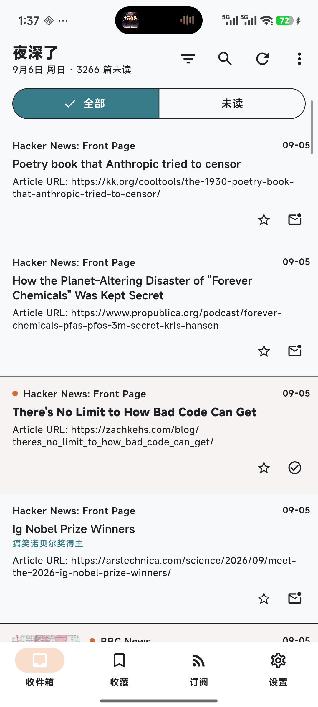
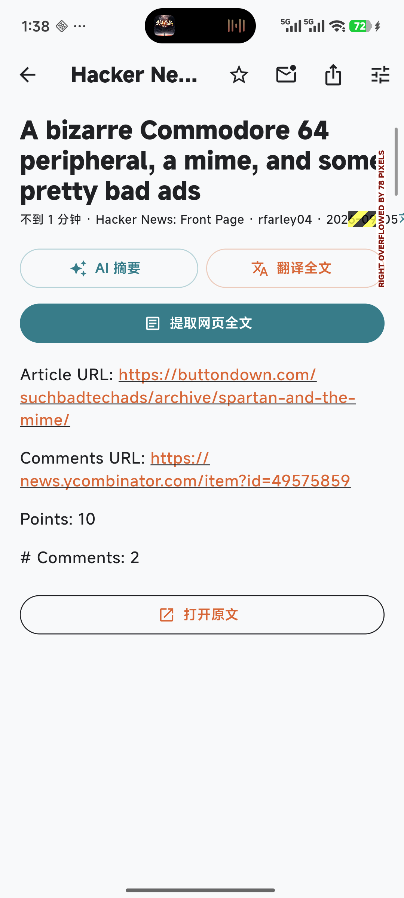

# Aurora Mobile

[](https://github.com/xiongsircool/aurora-rss-reader/actions/workflows/mobile-ci.yml)
[](https://github.com/xiongsircool/aurora-rss-reader/blob/main/LICENSE)
[](https://github.com/xiongsircool/aurora-rss-reader/releases/tag/mobile-v0.1.4)

**Aurora Mobile** 是 [Aurora RSS Reader](../../README_ZH.md) 的 Flutter 移动端。

**本地优先**：无账号、无服务器、无遥测。你的订阅、文章、阅读记录和 AI 设置全部只保存在设备上。

支持 Android 与 iOS。

<p align="center">
  
  
  
  
</p>

## 📥 下载

前往 [Releases](https://github.com/xiongsircool/aurora-rss-reader/releases) 获取最新 APK。

| 文件 | 适用 |
|---|---|
| `Aurora-*-arm64.apk` | 2019 年后设备推荐 |
| `Aurora-*-universal.apk` | 不确定设备架构时 |

iOS 通过 TestFlight 分发（开发中）。

## ✨ 功能

### 阅读
- 📡 RSS 1.0/2.0、Atom、Media RSS、播客全格式解析
- 🌐 UTF-8/16、GBK、Big5、Shift-JIS 多编码自动检测
- 📖 网页全文提取（Mozilla Readability）+ 离线缓存
- 🈶 中文场景：Bilibili 视频卡片、GBK 编解码、国内源兼容
- 🔍 FTS5 全文搜索（5 万篇毫秒级）+ 关键词高亮
- 📖 阅读进度记忆、字号/行距/衬线字体调节、代码块复制
- 🖼️ 图片点击放大、保存到相册

### 标签与过滤
- 🏷️ 手动标签：阅读中打标、收藏页按标签浏览、重命名/改色管理
- 🤖 规则自动打标：14 类目中英词典（科技/AI/编程/科研/生物…），
  DOI 文献自动归「科研」、PMID 归「科研+生物」，支持历史补打
- 🚫 过滤规则：关键词（| 分隔）或正则，屏蔽/标已读/自动收藏，
  全局或单源生效，保存即作用于现有文章，带命中统计

### 朗读（TTS）
- 🔊 听全文：系统语音离线朗读，从当前阅读位置开始
- 📜 沉浸式朗读页：逐句高亮、自动滚动、点句跳读
- 🎛️ 全局迷你条 + 倍速（0.75–2.0x），与播客互斥，锁屏可续播
- ✅ 可选「朗读完成自动标为已读」

### AI（自带 API Key，不经过 Aurora 服务器）
- 📝 文章摘要生成（DeepSeek / SiliconFlow）
- 🌍 全文双语对照翻译、标题实时翻译（视口触发，同语言跳过）

### 播客
- 🎧 音频播放器：倍速（0.75–2.0x）、进度记忆、跨页面持续播放
- 📱 全局迷你播放条：返回列表后仍可控制，锁屏后台不断音

### 界面与体验
- 🌙 深色模式（跟随系统）
- 💬 刷新失败可见化：失败原因 + 单源重试
- 📤 分享：链接 / 文本 / Markdown / 截图 / 品牌分享卡片图
- 🔔 本地通知 · WorkManager 后台刷新（1–24h 可选）
- 📂 分组管理 · OPML 导入导出 · 悬浮胶囊导航 · 右侧拖动滚动条
- 🌐 网页地址自动发现 RSS 链接（`<link rel=alternate>`）
- 🖼️ 订阅源站点图标自动获取（HTML → favicon.ico → DuckDuckGo 多级回退）

## 📱 平台

| 平台 | 状态 | 分发 |
|---|---|---|
| Android | ✅ 已验证 | [GitHub Releases](https://github.com/xiongsircool/aurora-rss-reader/releases) |
| iOS | ✅ 已验证 | TestFlight（筹备中） |
| iPad | ✅ 宽屏双栏 + 侧边导航 | 同 Android |

## 🚀 开发

```bash
# 工具链：Flutter 3.47+ / JDK 17 / Android SDK 36
cd rss-mobile
flutter pub get
flutter run            # 真机或模拟器
flutter test           # 167 项测试
flutter analyze
flutter build apk --release --split-per-abi
```

### i18n

支持中文（默认）和英文。新增文案请编辑 `lib/l10n/app_zh.arb` 和 `app_en.arb`，然后运行：

```bash
flutter gen-l10n
```

## 🏗️ 架构

```
lib/
├── app/            # MaterialApp 入口、亮暗主题
├── application/    # 用例层（刷新、提取、AI 生成）
├── data/           # Drift/SQLite 存储、HTTP 适配器、AI 客户端
│   ├── database/   # Drift 表定义 + schema 版本化迁移
│   ├── platform/   # secure_storage、通知
│   ├── repositories/ # 内容仓库（FTS5、游标分页）
│   └── services/   # favicon 解析、备份、阅读统计
├── domain/         # 纯 Dart 领域模型（Feed/Entry/解析/编码/翻译/音频）
├── features/       # UI 页面
│   ├── audio/      # 播客引擎接口 + 全局播放控制器
│   ├── inbox/      # 收件箱列表 + 继续阅读
│   ├── reader/     # 阅读页 + 播放器 + 分享预览
│   ├── search/     # 搜索（防抖 + 高亮）
│   ├── settings/   # 分组设置 + 关于页
│   └── sources/    # 订阅管理 + 添加流程
├── l10n/           # ARB 翻译源文件 + 生成代码
├── platform/       # 通知、后台刷新
└── shared/         # 跨功能组件（毛玻璃、滚动条、阅读统计、分享卡片渲染）
```

### 关键设计决策

- **存储**：Drift (SQLite) + FTS5，schema 版本化迁移（当前 v6），已读/收藏/翻译/播客进度持久化
- **网络**：`IoFeedHttpClient` 封装 gzip/deflate 解压、重定向、体积限制（10MB）、超时（30s）、反爬 UA；挂起响应立即取消不阻塞
- **AI**：流式生成（SSE），用户自带 Key，不经过 Aurora 服务器
- **图标**：多策略解析（页面 HTML → favicon.ico → DuckDuckGo），验证后缓存
- **播客**：`PodcastController` 管理全局播放状态，页面销毁不影响播放；进度每 10 秒持久化 + dispose 兜底
- **分享**：`ShareCardRenderer` 用 Canvas 绘制品牌卡片图，QR 码同步绘制后导出

## 📄 许可

GPL-3.0 — 详见 [LICENSE](../LICENSE)。
